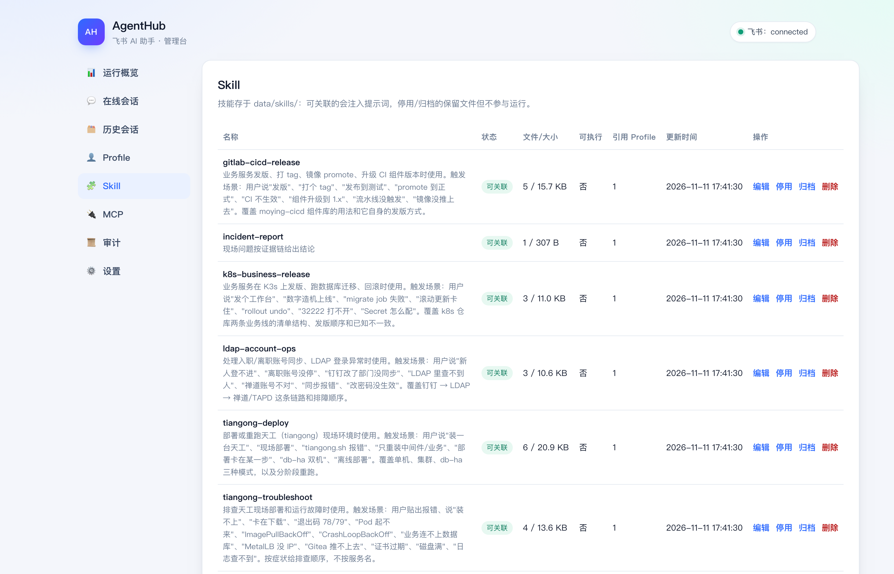
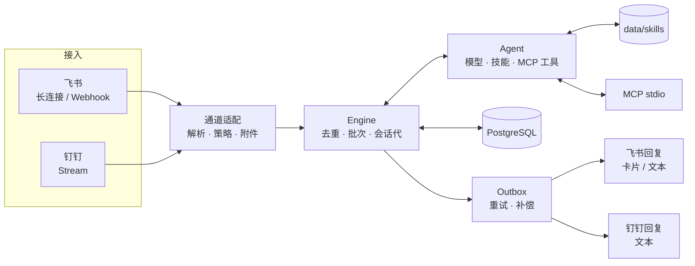

# AgentHub

**飞书 / 钉钉里的团队 AI 同事：能查、能做、有过程、可治理。**

把「描述问题 → 补材料 → 要结论 → 交付文件」做成一条可追踪、可复用、可治理的对话服务，
而不是又一个网页聊天框。

[](https://github.com/dongdonglog/Agenthub/actions/workflows/ci.yml)
[](https://github.com/dongdonglog/Agenthub/actions/workflows/release.yml)
[](https://hub.docker.com/r/donglog/agenthub)
[](https://go.dev)

---

## 为什么需要它

企业里的 AI 很容易停在「演示阶段」，通常卡在三件事：

| 断点 | 常见表现 | AgentHub 的做法 |
|---|---|---|
| **进不了工作流** | 要开网页、复制粘贴，同事不用 | 入口就在飞书/钉钉群或私聊，@ 一下就开始 |
| **看不到过程** | 只有一个转圈，出错不知道卡哪 | 进度卡片 + 阶段事件，运行详情可回放 |
| **没法治理** | 技能、工具、模型散在配置文件里 | 管理台统一管理，改动留审计，配置按会话代生效 |

一句话：**把 AI 从「聊天工具」变成「团队里可交付的同事」。**

## 它能做什么

- **在群里直接干活**：飞书 / 钉钉，@机器人 或免 @ 群里直接说，支持引用消息补充上下文；
- **带着技能回答**：把运维手册、发版流程写成 Markdown 技能，回答时自动遵循；
- **调用真实工具**：MCP stdio 工具（时间、部署脚本、内部系统）可被模型按需调用；
- **看图、看文件**：截图交给视觉模型，附件落盘后可由模型读取；
- **过程可见**：先发「正在分析」卡片，完成后原地更新为结果；长文自动分块；
- **可控**：`/stop` 停止、`/reset` 开新会话代、Profile 绑定到会话代；
- **可追溯**：每条消息有 `trace_id`，运行、工具调用、投递日志能串起来；
- **可运维**：健康检查、Prometheus 指标、备份恢复脚本、告警规则、容器镜像。

## 界面

管理台默认只监听回环，远端用 SSH 隧道访问。




## 架构



两条链路各自独立：

- **入站**：飞书长连接 / 钉钉 Stream → 通道适配（解析、@ 判断、白名单、附件）→ Engine；
- **出站**：Outbox → 回到消息来源通道（飞书卡片或文本，钉钉文本）。


一次运行：

```
消息 → 解析/策略 → 落库 → 批次快照 → 历史上下文 → 模型（技能 + 工具）
     → 卡片/文本 → 投递（失败重试、重启补偿）→ 运行事件与 token 落库
```

几条不变量（有测试守护）：

- 同一会话同时最多一个运行；
- 批次创建后输入冻结，新消息进下一批；
- 先落库再 ACK，投递用幂等键去重；
- 卡片/表情等投影失败不影响业务状态；
- `/reset` 递增会话代，旧代历史不进入提示词。

## 快速开始

### 用已发布镜像（推荐）

```bash
cp .env.example .env
# 飞书：FEISHU_APP_ID / FEISHU_APP_SECRET / FEISHU_BOT_OPEN_ID
# 钉钉：AGENTHUB_CHANNEL=dingtalk + DINGTALK_CLIENT_ID / DINGTALK_CLIENT_SECRET
# 都要：POSTGRES_PASSWORD

AGENTHUB_TAG=0.1.2 docker compose pull
AGENTHUB_TAG=0.1.2 docker compose up -d
```

镜像 `donglog/agenthub` 支持 `linux/amd64` 与 `linux/arm64`，打 tag 自动构建发布。

### 从源码构建

```bash
git clone https://github.com/dongdonglog/Agenthub.git
cd Agenthub
cp .env.example .env
docker compose up -d --build
```

端口默认 `127.0.0.1:8787`（健康/指标）与 `127.0.0.1:8788`（管理台），可用
`AGENTHUB_HTTP_PORT` / `AGENTHUB_ADMIN_PORT` 覆盖。

### 本地开发

```bash
cp .env.example .env   # 不填数据库则为内存模式，重启丢数据
go run ./cmd/agentd
```

## 接入

### 飞书

1. 开放平台创建**企业自建应用**，添加「机器人」能力；
2. 事件订阅选 **长连接接收**，订阅 `im.message.receive_v1`；
3. 申请权限：`im:message`、`im:message:send_as_bot`、`im:resource`、`im:chat:readonly`，
   免 @ 群还需要 `im:message.group_msg`（需审批）；
4. 发布应用并把机器人拉进群；
5. 把 `App ID` / `App Secret` / 机器人 `open_id` 填进 `.env`；
6. 白名单：`FEISHU_ALLOWED_USERS`（留空 = 拒绝所有人）、`FEISHU_ALLOWED_GROUPS`；
   测试群免 @ 把 `openConversationId` 填进 `FEISHU_MENTION_FREE_CHATS`。

### 钉钉（Stream 模式）

1. 钉钉开放平台创建**企业内部应用**，添加机器人；
2. 消息接收模式选择 **Stream 模式**；
3. 申请机器人发消息权限（可选：通讯录读取用于展示姓名）；
4. 把 `Client ID` / `Client Secret` 填进 `.env`，并设置 `AGENTHUB_CHANNEL=dingtalk`；
5. 可选：`DINGTALK_REQUIRE_MENTION`、`DINGTALK_ALLOWED_USERS`、`DINGTALK_ALLOWED_CHATS`、`DINGTALK_BOT_NAME`。

钉钉回复走会话 `sessionWebhook`（有效期约 1.5 小时），长任务超过有效期会投递失败；
卡片暂未接入，进度以文本呈现。详见 [部署指南](docs/deploy.md)。

## 技能

技能是一组 Markdown：`SKILL.md` 写流程，`references/` 放清单和手册。回答时注入系统提示词，
由模型自行判断是否适用。

**仓库不内置业务技能**，每个部署方自带：

- 把技能目录放进数据目录（容器里是 `/data/skills`，可用 volume 挂载）；
- 或在管理台「Skill → 导入 ZIP」上传整包；
- 示例模板见 `examples/skills/example/SKILL.md`。

管理台可以编辑文件树、新建/删除文件、停用/归档/删除。技能在同一部署内是共享的；
Profile 只用来切换“技能/MCP 组合”，不做按群路由——需要完全隔离时，部署独立实例或独立机器人。

## 管理台

| 页面 | 内容 |
|---|---|
| 运行概览 | 通道状态、模型、计数、在线试跑 |
| 在线会话 | 显示群名/发送人（飞书与钉钉均自动解析），分页；进入详情可重绑 Profile |
| 历史会话 | 按会话代聚合，可点进消息详情 |
| Profile | 技能/MCP 组合档案，应用后影响新会话代 |
| Skill | 分页列表（状态/文件数/大小/可执行/引用）；编辑进入独立页面，支持文件树与 ZIP 导入 |
| MCP | 分页列表；新建/编辑进入独立页面 |
| 审计 | 管理面写操作记录，支持 `X-AA-Operator` 透传操作者 |
| 设置 | 模型配置（Base URL / 模型 / 备用 / 视觉 / API Key）在线修改，其余配置只读 |

调度：跨会话并发（默认 4），排队按「基础优先级 + 等待老化」排序。私聊默认 10、群聊默认 5，
可在会话详情改优先级；等待每分钟 +2，避免低优先级长期饥饿。概览页可看当前队列。

模型配置也可以在管理台「设置」里直接改（保存到 `data/settings.yaml`，下一次运行生效，
API Key 只显示掩码）。其余配置仍由 `.env` 控制。

设置 `AGENTHUB_ADMIN_TOKEN` 后需要 Bearer 或 `/admin/login?token=...` 登录，写操作要求
`X-Requested-With: agenthub` 头防 CSRF。

## 常用配置

| 变量 | 默认 | 说明 |
|---|---|---|
| `AGENTHUB_CHANNEL` | `off` | `off` 骨架 / `feishu` 飞书 / `dingtalk` 钉钉 |
| `AGENTHUB_DB_URL` | 空 | 空则内存模式 |
| `FEISHU_TRANSPORT` | `websocket` | `websocket` / `webhook` |
| `FEISHU_REQUIRE_MENTION` | `true` | 群聊是否必须 @ |
| `FEISHU_ENCRYPT_KEY` | 空 | 配置后校验回调签名并解密 |
| `AGENTHUB_AGENT_MODEL` | `gpt-4.1-mini` | 主模型 |
| `AGENTHUB_AGENT_FALLBACK_MODEL` | 空 | 主模型失败兜底 |
| `AGENTHUB_AGENT_VISION_MODEL` | 空 | 图片消息使用的视觉模型 |
| `AGENTHUB_RETENTION_DAYS` | `90` | 历史数据保留天数 |
| `AGENTHUB_MAX_CONCURRENT_RUNS` | `4` | 跨会话并发运行上限 |
| `AGENTHUB_RATE_LIMIT_PER_MIN` | `0` | 每会话每分钟消息上限，0 关闭 |
| `AGENTHUB_ADMIN_TOKEN` | 空 | 管理台访问令牌 |
| `DINGTALK_CLIENT_ID` | 空 | 钉钉应用 Client ID |
| `DINGTALK_CLIENT_SECRET` | 空 | 钉钉应用 Client Secret |
| `DINGTALK_REQUIRE_MENTION` | `true` | 群聊是否必须 @机器人 |
| `DINGTALK_ALLOWED_USERS` | 空 | 钉钉 staffId 白名单 |
| `DINGTALK_ALLOWED_CHATS` | 空 | 会话 ID 白名单 |
| `DINGTALK_BOT_NAME` | 空 | 用于去掉文本开头的 @机器人 |

完整列表见 [运维手册](docs/runbook.md)。

## 运维

```bash
./scripts/backup.sh      # pg_dump + /data 卷归档，默认保留 14 天
./scripts/restore.sh backups/db-xxx.dump [data-xxx.tar.gz]

curl -s 127.0.0.1:8787/healthz
curl -s 127.0.0.1:8787/metrics | grep agenthub_
```

- 指标：`agenthub_health_check{check="db"|"feishu"|"dingtalk"}`、运行/投递/消息计数；
- 告警：`deploy/prometheus/alerts.yml`（不可达、飞书断开、运行/投递失败、调用量异常）；
- 发版：`git tag v1.2.3 && git push origin v1.2.3`，Actions 跑测试后构建双架构镜像。

## 测试

```bash
go test ./...          # 单元 + 集成，数据库用例自动跳过
go test -race ./...

# 真实 PostgreSQL：独立测试库 + 串行
AGENTHUB_TEST_DATABASE_URL='postgres://.../agenthub_test?sslmode=disable' \
  go test -p 1 ./internal/core ./internal/store
```

132 个用例覆盖批次、去重、取消竞态、投递重试、重启恢复、卡片、附件、MCP、技能、管理台、
飞书与钉钉接入。

## 目录

```
cmd/agentd/                入口与装配
internal/platform/feishu/  飞书长连接、事件、卡片、附件
internal/platform/dingtalk/ 钉钉 Stream、命令、会话回复
internal/core/             受理、批次、会话代、投递、事件
internal/agent/            模型、技能、工具、视觉
internal/mcp/              MCP stdio 客户端
internal/admin/            管理台与 API
internal/store/            PostgreSQL、迁移、持久化
migrations/                SQL 迁移（只前进）
examples/skills/           技能模板（不含业务内容）
deploy/prometheus/         告警规则
scripts/                   备份与恢复
docs/                      PRD、架构、部署、运维、路线图
```

## 边界

- **单实例**：飞书/钉钉长连接都是集群模式，目前一个应用只跑一个实例（多实例分片在路线图里）；
- **卡片停止按钮**需要飞书能访问 `/feishu/card`，没有公网入口时用 `/stop`；
- **钉钉**回复走 `sessionWebhook`（约 1.5 小时有效），超长任务可能投递失败；钉钉暂未接入卡片与附件下载；
- **技能全量注入**：技能很多时需要改为检索式加载，当前按 64KB 预算截断；
- **管理台**没有内建用户体系，建议只在内网或网关后暴露。

## 文档

[项目介绍](docs/intro.md) ·
[部署指南](docs/deploy.md) ·
[架构](docs/architecture.md) ·
[飞书能力](docs/feishu-capabilities.md) ·
[运维手册](docs/runbook.md) ·
[PRD](docs/PRD.md) ·
[路线图](docs/roadmap.md)
