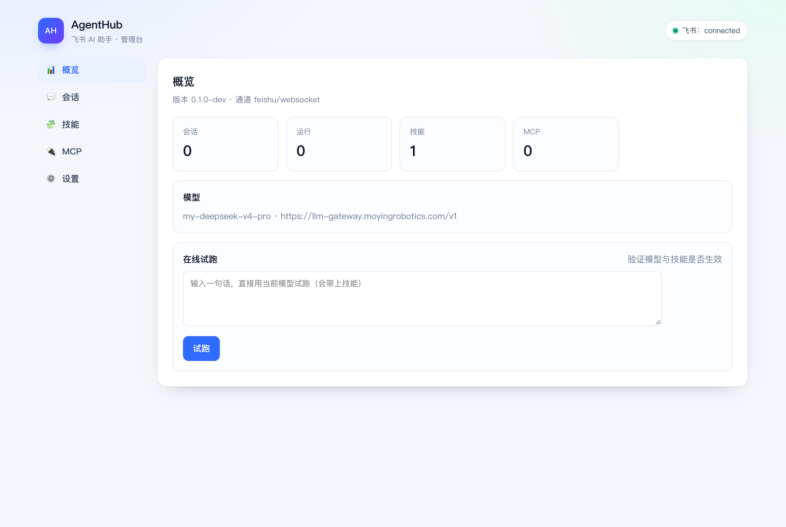

# AgentHub

飞书优先的团队 AI 助手：把"描述问题 → 补材料 → 要结论 → 交付文件"做成可追踪、可复用、可治理的对话服务。

Go 实现，单二进制，PostgreSQL 为唯一事实源。

## 快速开始

```bash
# 只起骨架（不接通道、不需要数据库）
make run

curl -s localhost:8787/healthz
# {"status":"ok","version":"0.1.0-dev","checks":{"config":"ok","db":"skipped"}}
```

接飞书（默认长连接，不需要公网入口）：

```bash
cp .env.example .env      # 填 FEISHU_APP_ID / FEISHU_APP_SECRET / FEISHU_BOT_OPEN_ID
set -a && . ./.env && set +a
go run ./cmd/agentd
```

事件接入方式：

| 方式 | 配置 | 说明 |
|---|---|---|
| WebSocket 长连接（默认） | `FEISHU_TRANSPORT=websocket` | 无需公网入口与回调地址；SDK 负责握手、心跳与自动重连；断线按指数退避重试 |
| 事件回调 | `FEISHU_TRANSPORT=webhook` + `AGENTHUB_WEBHOOK_ADDR` | 需要飞书能访问到该地址，适合已有网关的部署 |

## 管理台

启动后打开 **http://127.0.0.1:8788/admin/**（默认只绑回环；远端访问用 SSH 隧道或网关）。



| 页面 | 内容 |
|---|---|
| 概览 | 通道连接状态、模型配置、会话/运行/技能/MCP 数量 |
| 会话 | 会话列表；点进去看消息与运行，运行可点开看阶段与工具调用事件（事件落 `run_trace`） |
| 技能 | Markdown 技能增删改，保存到 `data/skills/*.md`，下次运行自动生效 |
| MCP | MCP 配置增删改，保存到 `data/mcp.yaml`（运行时接入在下一阶段） |
| 设置 | 当前模型与飞书配置，只读；改 `.env` 后重启 |

接模型（OpenAI 兼容，Ark / DeepSeek / OpenAI 都行）：

```bash
AGENTHUB_AGENT_BASE_URL=https://ark.cn-beijing.volces.com/api/v3
AGENTHUB_AGENT_API_KEY=...
AGENTHUB_AGENT_MODEL=deepseek-v3-250324
```

不填 `AGENTHUB_AGENT_API_KEY` 时使用回显执行器（收到什么回什么），方便先验证链路。

## 进度卡片

每次运行会发一张可更新的交互卡片：创建时显示「处理中 · 已收到 N 条消息」，执行中按阶段刷新（正在分析 / 正在调用工具），结束时更新为「处理完成」或「处理失败」并承载最终结果。

- 结果超过 3000 字时卡片显示「结果较长」，正文退回普通文本，避免截断；
- 文本超过 3500 字会按段落分块发送，首块建立回复关系，其余顺序追加；
- 卡片创建或更新失败时自动退回纯文本；
- 停止仍用 `/stop`（飞书卡片按钮回调需要额外入口，暂未接入）。

## 多轮上下文

每次运行会把同会话**当前代**最近 20 条已完成消息（用户+助手）作为历史一起发给模型，助手回复也会落库；因此连续追问能继承前文，不依赖"把话一次说完"。

`/reset` 会开启新代：旧上下文不再进入提示词，但历史消息仍保留在库里可追溯。

## 引用

回复某条消息再提问时，服务会读取被引用消息的正文并附在提示词前（`（引用消息：…）`），模型能据此理解"这个结论对吗"之类的问题。

**回复机器人的消息等同于 @机器人**：群里直接引用它上一条回复继续追问即可，不必重新 @。

## 命令

在飞书里 @机器人 后发送：

| 命令 | 作用 |
|---|---|
| `/status` | 当前是否在处理、排队多少条 |
| `/model` | 当前模型与网关地址 |
| `/stop` | 停止当前批次（保留排队消息） |
| `/clear` | 取消全部排队消息 |
| `/reset` | 停止、清空并开启新会话代（不再携带旧上下文） |
| `/help` | 命令列表 |

命令不进队列、不调用模型，直接回复。

## 附件

图片/文件消息会异步流式下载到 `data/attachments/<message_id>/`，下载完成后才入队：

- 小于 64KB 的文本类附件（`.log/.txt/.md/.json/.yaml/.csv` 等）直接内联进提示词；
- 其他附件给出本地路径，模型用内置 `read_file` 工具读取（限制在附件目录内，默认 256KB）。

## 投递可靠性

- 发送失败按指数退避重试（1s → 2s → 4s，封顶 30s），最多 3 次；
- 每次尝试与状态写入 `delivery_state`，进程重启后对 `pending/retrying` 的记录继续投递；
- 3 次仍失败标记 `failed` 并写日志，不会无限重试。

## 持久化

配置 `AGENTHUB_DB_URL` 后，消息、运行与投递写库；启动时自动执行 `migrations/` 下未应用的 SQL，并恢复最近状态（`processing` 的消息会重新排队）。不配置数据库时仍是内存模式。

## 技能与 MCP

技能目录支持两种布局，`SKILL.md` 的 YAML frontmatter 优先：

```text
data/skills/
  tiangong-troubleshoot/
    SKILL.md          # --- name / description --- 正文
  incident-report.md  # 兼容扁平格式
```

MCP 走 stdio，启动时拉起进程并 `initialize` + `tools/list`，工具以 `mcp_<server>_<tool>` 暴露给模型：

```yaml
# data/mcp.yaml
- name: demo
  transport: stdio
  command: python3
  args: ["examples/mcp/time_server.py"]
  enabled: true
```

工具调用过程会写日志 `tool call`，失败返回「工具执行失败」给模型自行处理。

## 本地模拟（不需要真实飞书应用）

`go test ./...` 覆盖了完整链路，不访问外网：

| 用例 | 验证点 |
|---|---|
| `TestMessageEndToEnd` | 事件 → 解析 → 批次 → 执行 → 回复（fake 飞书 API） |
| `TestDuplicateEventDeliversOnce` | 重复推送只投递一次 |
| `TestGroupWithoutMentionIsIgnored` | 群聊未 @机器人 不处理 |
| `TestRapidMessagesMergeIntoOneBatch` | 3 条连发合并为 1 次运行 |
| `TestStopInterruptsRun` | 停止后运行中断且仍投递说明 |
| `TestRejectsWrongToken` / `TestChatAllowlist` | 来源校验与白名单 |
| `TestRawPayloadPrefersRawBody` | 长连接事件走与 webhook 相同的解析路径 |
| `TestDispatcherHandlesWebsocketPayload` | 长连接报文 → 解析 → 批次 → 投递 |
| `TestConnectorContract` | Connector 契约：多事件、多会话分发 |

手动起服务验证事件入口：

```bash
AGENTHUB_CHANNEL=feishu \
FEISHU_APP_ID=cli_sim FEISHU_APP_SECRET=sim \
FEISHU_VERIFICATION_TOKEN=vt \
AGENTHUB_WEBHOOK_ADDR=127.0.0.1:8789 \
go run ./cmd/agentd

curl -s -X POST localhost:8789/feishu/events \
  -H 'Content-Type: application/json' \
  -d '{"type":"url_verification","challenge":"c-123","token":"vt"}'
# {"challenge":"c-123"}
```

## 目录

| 路径 | 说明 |
|---|---|
| `cmd/agentd` | 服务入口：装配、信号、退出码 |
| `internal/channel` | 与平台无关的入站消息与发送接口 |
| `internal/core` | 受理、去重、批次快照、会话串行、投递（当前内存实现） |
| `internal/agent` | 执行器契约（当前为回显实现，M2 接模型） |
| `internal/platform/feishu` | 飞书事件解析、OpenAPI 客户端、回调入口 |
| `internal/config` | 配置加载与校验（环境变量 > YAML > 默认值） |
| `internal/obs` | 结构化日志与 Prometheus 指标 |
| `internal/store` | PostgreSQL 连接、迁移与状态持久化 |
| `internal/httpapi` | `/healthz`、`/metrics` 与管理面 |
| `migrations` | SQL 迁移（只前进；goose 在 M1 接入） |
| `docs` | PRD、架构、飞书能力、运维、路线图 |

## 文档

- [PRD](docs/PRD.md)
- [架构设计](docs/architecture.md)
- [飞书能力矩阵](docs/feishu-capabilities.md)
- [运维手册](docs/runbook.md)
- [路线图](docs/roadmap.md)

## 常用命令

```bash
make run          # 本地运行
make test         # 单元测试
make build        # 产出 bin/agentd
make fmt          # gofmt
make vet          # go vet
```

## 状态

- **M0 骨架**：配置校验、日志、指标、健康检查、迁移脚本、优雅退出。
- **M1 飞书闭环（进行中）**：事件解析（文本/富文本/图片/文件/音视频）、去重、白名单、
  群聊 @ 判定、批次合并、会话串行、停止、投递（回复原消息）已打通，并有 fake API 全链路测试。
- **长连接（已完成）**：`FEISHU_TRANSPORT=websocket` 为默认；SDK 负责握手与重连，
  服务侧带指数退避重试；`/healthz` 暴露 `feishu: connecting|connected|reconnecting`。
- **M1 待补**：附件流式下载、真实模型接入。
- **M2+**：PostgreSQL 持久化、outbox 重试、卡片与表情。

详细排期见 [路线图](docs/roadmap.md)。
