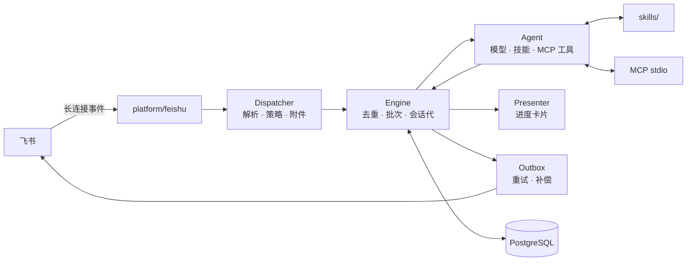

# AgentHub

飞书优先的团队 AI 助手：把「描述问题 → 补材料 → 要结论 → 交付文件」做成可追踪、可复用、可治理的对话服务。

Go 单二进制，PostgreSQL 为事实源，飞书长连接接入，无需公网入口。

## 特性

| 域 | 能力 |
|---|---|
| 接入 | 飞书 WebSocket 长连接（默认）/ Webhook；私聊与群聊；免 @ 群白名单 |
| 输入 | 文本、富文本、图片（视觉模型）、文件（落盘 + `read_file`）、引用上下文 |
| 交互 | 进度卡片、结果卡片、停止按钮（可选）、长文本分块、`/` 命令 |
| 智能 | Markdown 技能注入、MCP 工具调用、多轮上下文、会话代重置 |
| 可靠 | 去重、批次快照、持久化、投递重试与重启补偿、模型重试与备用模型 |
| 治理 | 管理台（概览/会话/运行详情/技能/MCP）、运行事件与 token 用量 |
| 工程 | 单元 + 集成测试、GitHub Actions、Docker Compose |

## 架构



一次运行：`消息 → 解析/策略 → 落库 → 批次 → 历史上下文 → 模型（技能+工具） → 卡片/文本 → 投递`。

## 快速开始

### 本地

```bash
cp .env.example .env   # 填飞书凭据；不填 DB 则为内存模式
go run ./cmd/agentd
```

健康检查：`curl localhost:8787/healthz`，管理台：<http://127.0.0.1:8788/admin/>。

### Docker Compose

```bash
cp .env.example .env
# 必填：FEISHU_APP_ID / FEISHU_APP_SECRET / FEISHU_BOT_OPEN_ID / POSTGRES_PASSWORD
docker compose up -d --build
```

两个服务（app + postgres），数据在 `aadata` / `pgdata` 卷，迁移随启动自动执行，端口只发布到宿主机回环。

## 飞书应用配置

1. 开放平台创建**企业自建应用**，添加「机器人」能力；
2. 事件订阅选 **使用长连接接收事件**，订阅 `im.message.receive_v1`；
3. 申请权限：

| 权限 | 用途 |
|---|---|
| `im:message` | 接收消息 |
| `im:message:send_as_bot` | 以机器人身份发送 |
| `im:resource` | 上传/下载素材 |
| `im:chat:readonly` | 群信息 |
| `contact:user.base:readonly` | 成员姓名等（可选） |
| `im:message.group_msg`（需审批） | 接收群内全部消息（免 @ 群需要） |

4. 发布应用，把机器人加入目标群；
5. 取 `App ID` / `App Secret`，写入 `FEISHU_APP_ID` / `FEISHU_APP_SECRET`；
6. 取机器人 `open_id` 写入 `FEISHU_BOT_OPEN_ID`：

```bash
TOKEN=$(curl -s -X POST https://open.feishu.cn/open-apis/auth/v3/tenant_access_token/internal \
  -H 'Content-Type: application/json' \
  -d '{"app_id":"<APP_ID>","app_secret":"<APP_SECRET>"}' | jq -r .tenant_access_token)
curl -s https://open.feishu.cn/open-apis/bot/v3/info -H "Authorization: Bearer $TOKEN" | jq .bot
```

7. 白名单：`FEISHU_ALLOWED_USERS`（**留空 = 拒绝所有人**）、`FEISHU_ALLOWED_GROUPS`；
8. 测试群免 @：把 `openConversationId` 写进 `FEISHU_MENTION_FREE_CHATS`。

## 配置

优先级：环境变量 > `config.yaml` > 默认值。启动校验失败退出码 2，日志只记字段名。

| 变量 | 默认 | 说明 |
|---|---|---|
| `AGENTHUB_CHANNEL` | `off` | `off` 骨架 / `feishu` 接飞书 |
| `AGENTHUB_HTTP_ADDR` | `127.0.0.1:8787` | 健康检查与指标 |
| `AGENTHUB_ADMIN_ADDR` | `127.0.0.1:8788` | 管理台（无内置登录） |
| `AGENTHUB_DB_URL` | 空 | 空则内存模式，重启丢数据 |
| `AGENTHUB_DATA_DIR` | `./data` | 附件、技能、MCP 配置 |
| `FEISHU_TRANSPORT` | `websocket` | `websocket` / `webhook` |
| `FEISHU_APP_ID` / `FEISHU_APP_SECRET` | 必填 | 应用凭据 |
| `FEISHU_BOT_OPEN_ID` | 空 | 机器人 open_id，用于识别 @ |
| `FEISHU_ALLOWED_USERS` | 空 | 用户白名单，空=全拒 |
| `FEISHU_ALLOWED_GROUPS` | 空 | 群白名单，空=不限 |
| `FEISHU_MENTION_FREE_CHATS` | 空 | 免 @ 群列表 |
| `FEISHU_REQUIRE_MENTION` | `true` | 群聊是否必须 @ |
| `FEISHU_CARD_ACTION` | `false` | 卡片停止按钮（需 `/feishu/card` 可达） |
| `AGENTHUB_AGENT_BASE_URL` | OpenAI | OpenAI 兼容地址 |
| `AGENTHUB_AGENT_API_KEY` | 空 | 空则回显模式 |
| `AGENTHUB_AGENT_MODEL` | `gpt-4.1-mini` | 主模型 |
| `AGENTHUB_AGENT_FALLBACK_MODEL` | 空 | 主模型失败兜底 |
| `AGENTHUB_AGENT_VISION_MODEL` | 空 | 图片消息使用的视觉模型 |
| `AGENTHUB_AGENT_SKILLS_DIR` | `<数据目录>/skills` | 技能目录 |

完整列表见 [docs/runbook.md](docs/runbook.md)。

## 技能

支持两种布局，`SKILL.md` 的 YAML frontmatter 优先：

```text
data/skills/
  tiangong-troubleshoot/
    SKILL.md          # --- name / description --- + 正文
  incident-report.md  # 兼容扁平格式
```

- 仓库 `skills/` 是**随发布分发的种子**：首次启动且数据目录为空时自动复制到 `data/skills/`；
  内置 6 个运维技能（天工部署/排障、K8s 业务发版、LDAP 账号、GitLab CI/CD、VictoriaLogs）；
- 管理台技能编辑器支持**文件树**：编辑 SKILL.md 与 `references/*.md`，可新建/删除文件；
- 支持 **ZIP 整包导入**：解压后按目录识别技能（拒绝 `..`/绝对路径，上限 20MB），同名需确认覆盖；
- SKILL.md 引用的 references 可用 `read_file` 读取（附件目录与技能目录都在允许范围内）；
- 管理台「技能」页可增删改，保存后下一次运行生效，无需重启；
- 每次运行把全部技能拼进系统提示词（名称 + 描述 + 正文），由模型自行判断是否适用。

## MCP

```yaml
# data/mcp.yaml
- name: demo
  transport: stdio
  command: python3
  args: ["examples/mcp/time_server.py"]
  enabled: true
```

启动时拉起进程、`initialize`、`tools/list`，工具以 `mcp_<server>_<tool>` 暴露给模型，自动参与 tool calling；单个服务失败只记日志。仅支持 stdio，HTTP 传输待做。

## 命令

群里 @机器人（免 @ 群直接发）后：

| 命令 | 作用 |
|---|---|
| `/status` | 当前状态与排队数 |
| `/model` | 当前模型与网关 |
| `/stop` | 停止当前批次 |
| `/clear` | 取消排队 |
| `/reset` | 停止、清空并开启新会话代 |
| `/help` | 命令列表 |

命令不入队、不调用模型。

## 管理台

`http://127.0.0.1:8788/admin/`（远端用 `ssh -L 8788:127.0.0.1:8788`）。

| 页面 | 内容 |
|---|---|
| 运行概览 | 通道状态、模型、计数、在线试跑 |
| 在线会话 | 会话列表 → 消息与运行；可对当前会话代重新应用 Profile |
| 历史会话 | 按会话代聚合，可点进消息详情 |
| Profile | 技能/MCP 组合档案；「应用」后新会话代绑定该档案，旧代保持原配置（`/reset` 后切换） |
| Skill | 名称/状态/文件数/大小/可执行/引用/更新时间；编辑、停用、启用、归档、删除 |
| MCP | 增删改 MCP 配置 |
| 审计 | 管理面写操作记录（技能、MCP、Profile、会话配置变更），支持 `X-AA-Operator` 透传操作者 |
| 设置 | 当前生效配置（只读） |

设置 `AGENTHUB_ADMIN_TOKEN` 后，管理面要求 Bearer Token 或先访问
`/admin/login?token=<TOKEN>` 获取 Cookie（HttpOnly + SameSite=Strict），写操作还需
`X-Requested-With: agenthub` 头防 CSRF。未设置时无鉴权，只应绑定回环或置于网关之后。

## 数据与保留

- 内存只保留近期数据：每会话最近 100 条消息、200 个会话、200 次运行、500 条投递；排队/处理中的消息不裁剪；
- 数据库保留 `AGENTHUB_RETENTION_DAYS`（默认 90 天），启动时与每 6 小时清理一次；排队消息和未完成投递不会被删。

## 数据与可靠性

- `message_state` / `run_state` / `delivery_state` / `run_trace`：消息、运行、投递、事件；
- 助手回复也落库，下一轮作为历史（当前代最近 20 条）；
- `/reset` 递增会话代，旧上下文不再进入提示词；
- 投递失败按 1s→2s→4s 重试，最多 3 次；重启后继续投递未完成记录；
- 429/5xx 自动重试并切换备用模型。

## 测试

```bash
go test ./...                                   # 单元 + 集成（数据库用例自动跳过）

# 真实 PostgreSQL：必须用独立测试库（测试会清空表），并串行跑包
AGENTHUB_TEST_DATABASE_URL='postgres://.../agenthub_test?sslmode=disable' \
  go test -p 1 ./internal/core ./internal/store
```

> 指向 `postgres` 库的测试会被自动跳过，避免误删应用数据。

## 常见问题

| 现象 | 排查 |
|---|---|
| 发消息没反应 | 看日志 `feishu message ignored reason=...`；群聊未 @ 或不在白名单 |
| 回调 403 | 配置了 `FEISHU_ENCRYPT_KEY` 但签名不匹配，或 Verification Token 不一致 |
| 长连接反复重连 | 应用凭据错误（`app_id is invalid`）或出网 443 不通 |
| 卡片不更新 | 卡片权限/模板；失败会自动回退文本 |
| 图片看不到 | 未配置 `AGENTHUB_AGENT_VISION_MODEL`，或模型不支持视觉 |
| 重启后会话为空 | 未配置 `AGENTHUB_DB_URL`（内存模式） |

## 目录

```
cmd/agentd/                入口与装配
internal/platform/feishu/  飞书通道：长连接、事件、卡片、附件
internal/core/             受理、批次、会话代、投递、事件
internal/agent/            模型、技能、工具、引用
internal/mcp/              MCP stdio 客户端
internal/admin/            管理台与 API
internal/store/            PostgreSQL、迁移、持久化
migrations/                SQL 迁移（只前进）
skills/                    随仓库分发的技能种子
examples/mcp/              示例 MCP 服务
docs/                      PRD、架构、运维、路线图
```

## 安全

- 配置 `FEISHU_ENCRYPT_KEY` 后，Webhook 与卡片回调校验 `X-Lark-Signature` 并解密 `encrypt` 载荷；
- 管理面可配 `AGENTHUB_ADMIN_TOKEN`，写操作要求 CSRF 头；

- 密钥只从环境变量读取，日志与归档不落明文；
- `read_file` 限制在附件目录内；
- 管理面无内置认证，必须限制来源；
- 生产建议：只读根文件系统、非 root、出网白名单、前缀网关做认证。

## 文档

- [PRD](docs/PRD.md) · [架构](docs/architecture.md) · [飞书能力](docs/feishu-capabilities.md) · [运维](docs/runbook.md) · [路线图](docs/roadmap.md)
