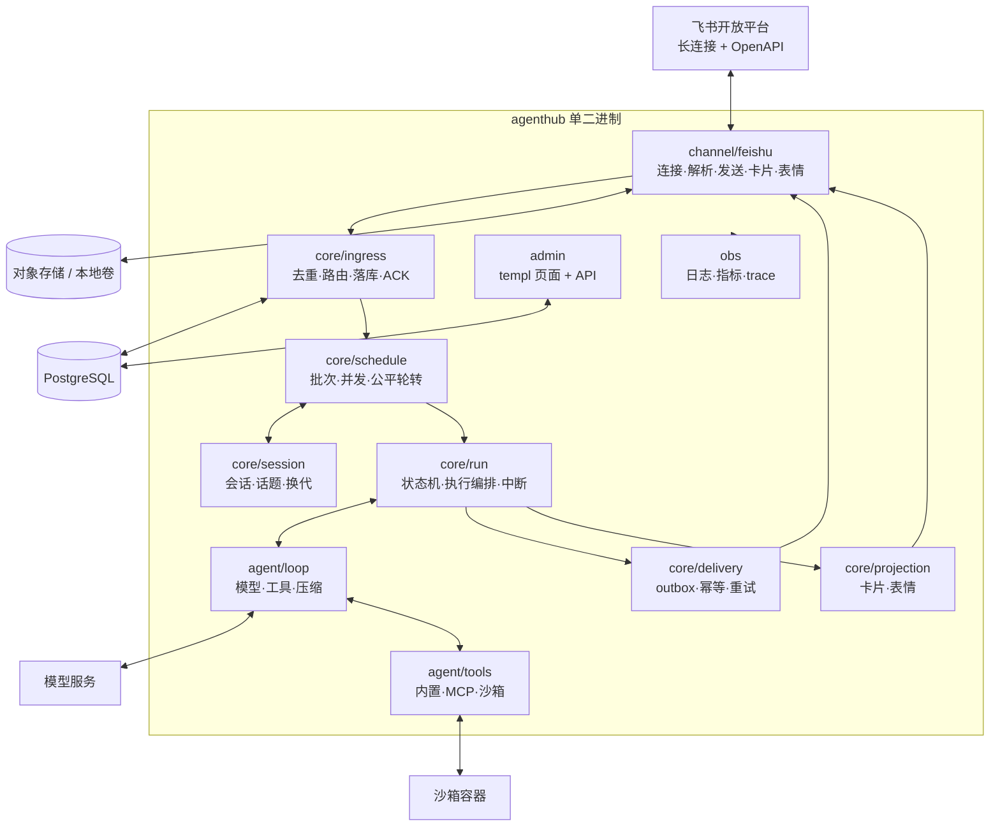
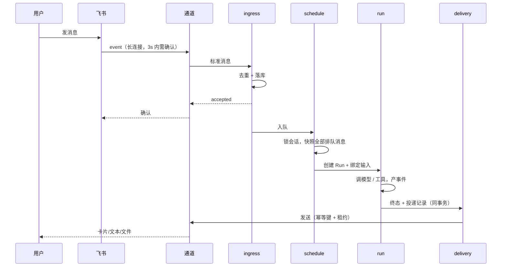

# 架构设计

## 1. 设计原则

1. **PostgreSQL 是唯一事实源**：消息、运行、投递状态都在库里；表情、卡片、文本只是投影。
2. **通道只做协议互转**：平台字段不出通道层，核心不出现 `chat_id`、`parent_id` 之类的平台概念。
3. **处理单位是"批"**：一次运行吃一批冻结输入，运行期间新消息进下一批。
4. **投影失败不回写业务状态**：卡片、表情、通知失败只降级。
5. **单二进制、模块化单体**：先用 `internal/` 划边界，不做微服务；需要时按模块拆。

## 2. 组件视图



## 3. 消息时序



## 4. Run 状态机

```
queued ──▶ running ──▶ completed
              │  │
              │  ├──▶ failed（模型/工具错误）
              │  └──▶ interrupted（停止/超时/崩溃恢复）
              ▼
           stopping ──▶ interrupted
```

规则：

- `queued → running` 由调度器在拿到并发名额后推进；
- 停止请求先写 `stopping`，再中止执行，最终落 `interrupted`；
- `interrupted` 与 `failed` 都必须产生一条"中断/失败说明"投递；
- 终态不可逆；迟到事件按 `run_id` 丢弃。

## 5. 数据模型

| 表 | 职责 | 关键约束 |
|---|---|---|
| `tenant` / `member` / `chat` | 租户、成员、会话容器 | `(tenant, open_id)`、`(tenant, chat_id)` 唯一 |
| `conversation` | 会话键 + 代 | `(tenant, chat, member, thread)` 唯一 |
| `message` | 入站/出站消息 | `(tenant, external_id)` 去重 |
| `message_attachment` | 附件元数据 | 流式写入、校验和 |
| `run` | 执行状态 | **部分唯一索引**保证同会话单活动 Run |
| `run_input` | 批次绑定 | `(run, position)` 唯一，只插不改 |
| `run_event` | 追加写事件 | 不可变 |
| `tool_call` | 工具调用审计 | 记录参数摘要与耗时（内存阶段先写日志） |
| `delivery` | 投递箱 | `idempotency_key` 唯一 |
| `reaction_projection` | 表情投影 | 期望态/已应用态 |
| `usage_record` | token 与成本 | 按 run 聚合 |
| `audit_event` | 管理审计 | 只追加 |

完整 DDL 见 `migrations/0001_init.sql`。

## 6. 关键决策（ADR）

### ADR-001 单二进制模块化单体
**决定**：不拆服务，用 `internal/` 与接口约束边界。
**理由**：团队规模小、部署简单、事务边界清晰；拆分可在有明确瓶颈后进行。

### ADR-002 PostgreSQL + River 做队列
**决定**：不引入 Redis/Kafka；投递重试、保留清理、定时任务用 River。
**理由**：队列与业务同库，事务一致；运维组件少。
**代价**：吞吐上限受 DB 限制，v1 够用。

### ADR-003 自研薄 Agent Loop
**决定**：自己实现流式 + 工具调用 + 取消 + 上下文预算；模型接入用官方 SDK。
**理由**：需要精确控制中止、预算与工具边界；框架抽象容易掩盖关键语义。
**备选**：Eino / ADK-Go；作为工具与模型适配的参考。

### ADR-004 沙箱用容器
**决定**：每次 Run 一个容器（或复用池），只读挂载工作区、egress 白名单、资源限额。
**理由**：工具含 shell，靠进程隔离不够；容器是当前最低成本的可验证边界。

### ADR-005 管理台用 templ + htmx
**决定**：服务端渲染，不引入前端构建链。
**理由**：单二进制交付；管理台交互复杂度低。

## 7. 不变量与落地方式

| 不变量 | 落地 |
|---|---|
| I1 同会话单活动 Run | `run` 部分唯一索引 + 事务内插入 |
| I2 批次冻结 | `run_input` 只插入，不更新 |
| I3 先落库后 ACK | 通道等待 `InboundHandler` 返回后再确认 |
| I4 终态与投递同事务 | `run` 更新 + `delivery` 插入同一事务 |
| I5 投影不回写 | 投影层只读状态，失败进重试队列 |
| I6 迟到事件丢弃 | 事件带 `run_id`，与当前运行不匹配即忽略 |

## 8. 错误分类

| 层 | 分类 | 处置 |
|---|---|---|
| 通道 | 限流 / 过期 / 拒绝 / 权限 / 网络 | 退避重试或降级 |
| 运行 | 模型错误 / 工具错误 / 超时 / 中止 | 转 `failed`/`interrupted`，必投递说明 |
| 投递 | 可重试 / 不可重试 / 结果不明 | 重试 / `failed` / `AMBIGUOUS` |

## 9. 目录结构

```
cmd/agentd/                 入口
internal/config/            配置
internal/obs/               日志、指标、trace
internal/store/             pgx、事务、查询
internal/channel/           Adapter 接口与能力声明
internal/platform/feishu/   飞书适配
internal/core/ingress/      受理
internal/core/session/      会话
internal/core/schedule/     调度
internal/core/run/          运行
internal/core/delivery/     投递
internal/core/projection/   投影
internal/agent/loop/        模型循环
internal/agent/tools/       工具与沙箱
internal/admin/             管理面
migrations/                 goose 迁移
docs/                       文档
```
