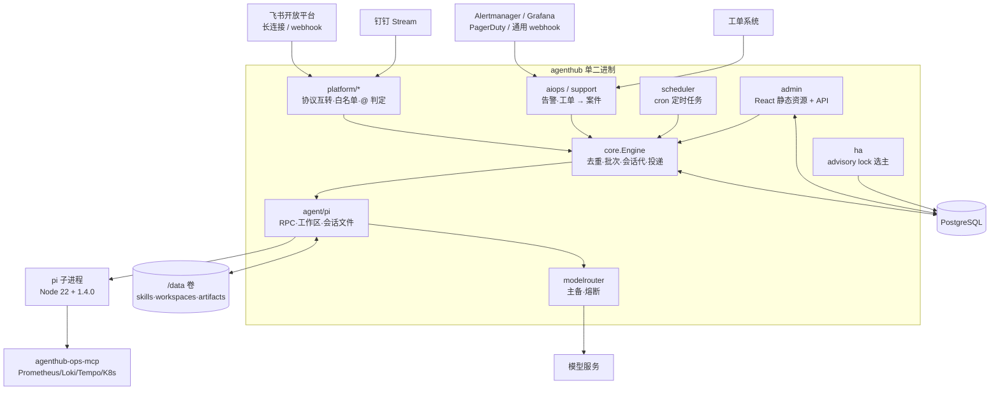
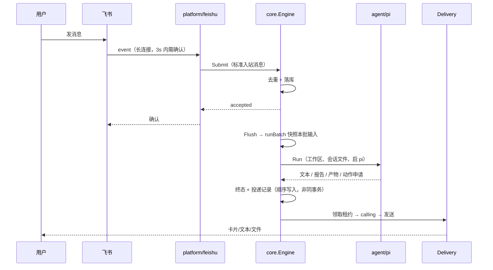

# 架构设计

> 本文描述**当前实现**。与代码冲突时以代码为准；接手时先读 `AGENTS.md`。

## 1. 设计原则

1. **PostgreSQL 是唯一事实源**：消息、运行、投递状态都在库里；表情、卡片、文本只是投影。
2. **通道只做协议互转**：平台字段不出 `platform/*`，核心不出现 `chat_id`、`parent_id` 之类的平台概念。
3. **处理单位是"批"**：一次运行吃一批冻结输入，运行期间新消息进下一批。
4. **投影失败不回写业务状态**：卡片、表情、通知失败只降级。
5. **单二进制、模块化单体**：用 `internal/` 划边界，不做微服务；需要时按模块拆。
6. **pi 负责想和写，Go 负责记住和送出去**：执行在子进程，治理在 Go。

## 2. 组件视图



要点：

- 只有 `cmd/agentd` 一个进程装配全部组件；`agenthub-ops-mcp` 是独立二进制，由 pi 以 MCP stdio 拉起。
- 管理台是 React 构建产物 `internal/admin/static`，通过 `//go:embed` 打进二进制。
- 部署边界是一个只读根文件系统的容器；**每次运行不再单独起容器**，隔离靠子进程 + 工作区，
  可选 Linux user namespace（`PI_ISOLATION=namespace`）。

## 3. 消息时序



注意与旧文档不同之处：终态与投递记录是**顺序写入**，不是同一事务；一致性靠幂等键与租约，
而不是事务。

## 4. Run 状态机

```
queued ──▶ running ──▶ completed
              │  │
              │  ├──▶ failed（模型/工具错误）
              │  └──▶ interrupted（停止/超时/崩溃恢复）
              ▼
           stopping ──▶ interrupted
```

规则：

- `queued → running` 由 `runBatch` 在拿到跨会话并发名额后推进；
- 同一会话同时最多一个非终态运行，由内存 `active[conv]` 守卫；
- 停止请求先记录 `stopping`，再中止执行，最终落 `interrupted`；
- `interrupted` 与 `failed` 都必须产生一条"中断/失败说明"投递；
- 终态不可逆；迟到事件按 `run_id` 归属丢弃；
- 发送前原子领取租约并进入 `claimed`；调用通道前进 `calling`；终态更新必须匹配租约令牌；
- 恢复扫描器只回收过期租约：`claimed` 重试，`calling` 标记 `ambiguous`，不自动重发；
- 排队消息超过 TTL 后标记 `expired`，不进入运行。

## 4.1 pi 运行时

一次运行由 `pi --mode rpc` 子进程执行：

- 会话代工作区：`.agenthub-agent/`（部署配置副本）、`AGENTS.md`、`attachments/`（只读）、
  `outbox/<run_id>/` 与指向本次目录的 `submit` 符号链接；技能/MCP 按 Profile 选择裁剪；
- 批次消息预写 pi 会话文件（v3 JSONL），最后一条通过 `prompt` 触发；
- 事件：`agent_start`、`message_update`、`tool_execution_start/end`、`message_end`、`agent_settled`；
- 收敛以 `agent_settled` 为准；超时/取消先 `clear_queue` 再 `abort`，宽限后杀进程组；
- 部署配置 `models.json`/`SYSTEM.md`/`skills`/`mcp.json` 在启动时生成，工作区创建时复制；
- 每次运行前按当前代 Profile 重新裁剪 `skills/` 与 `mcp.json`，Skill 根目录可执行文件链接到会话 `.agenthub-bin/` 并加入 `PATH`；
- 运行成功后收集 `submit/` 中的普通文件，复制到 `data/artifacts/<run_id>/`，按文本 → 图片 → 文档（多个打 ZIP）的顺序投递；
  超限或通道不支持时追加可读说明，产物仍保留供管理台查看；导入后清理本次工作区原件。

### 4.1.1 处置报告与动作申请

- `submit_report` 扩展把结构化报告写到 `reports/report.json`，Go 读取后 `reportSink` 落成
  `case_report` 草稿（`draft`），人补根因/验证后定稿；
- `request_approval` 扩展把动作申请写到 `approvals/*.json`，Go 读取后 `approvalSink`
  创建 `approval_request` 并推送审批卡片。**它不执行动作**；
- 执行只发生在审批通过之后：`internal/action` 重新校验参数与 namespace allowlist，再调 kubectl；
- 运行失败或未关联案件时，审批申请直接丢弃，不落库。

### 4.1.2 为什么用 pi（与内置 Go loop 的取舍）

| 维度 | 内置 Go loop（早期方案） | pi 运行时（当前） |
|---|---|---|
| 工具 | `read_file` + MCP | `read/bash/edit/write/grep/find/ls/tool_search` + MCP |
| 工具循环 | 自研，最多 6 轮 | pi 内置，含重试与结果回填 |
| 上下文 | DB 最近 20 条 | v3 会话文件，含工具轨迹 |
| 压缩 | 无 | compaction 扩展 |
| 恢复 | 靠 DB 历史重建 | 会话文件原样恢复 |
| 技能 | 全量拼进提示词（64KB） | pi 扫描 `skills/`，按需 `read` |
| 隔离 | 与主进程同权限 | 子进程 + 工作区；Linux 可选 unshare |
| 进度 | 阶段 + 工具名 | 文本增量、工具事件、thinking |

收益：真的能干活（bash/编辑/搜索）、长会话不炸、重启可恢复、技能标准化。
代价：镜像变大；每会话额外内存；每次运行多一次 Node 启动；pi 固定 1.4.0、会话文件 v3，
升级要回归；调试跨 Go/Node 两段；`bash` 靠容器限额兜底。

## 4.2 模型主备路由

- `internal/modelcfg`：供应商 / 模型 / 线路的配置与 v1→v2 迁移；
- `internal/modelrouter`：回环 OpenAI 兼容代理，负责候选选择、错误分类、流式边界、熔断与指标；
- pi 的 `models.json` 指向该代理，虚拟模型名即线路名（默认 `main`）；
- 启动时随机端口 + 内部 token，不对外暴露；配置变更热更新，无需重启。

## 4.3 定时任务

- 5 段 cron，按任务时区解释；20s 轮询一次；
- 抢占：`ClaimDue` 在一条 `UPDATE ... FOR UPDATE SKIP LOCKED` 里记录 `claimed_at` 并置空
  `next_run_at`，多实例不会重复执行；
- 回填：`FinishTask` 写入 `next_run_at` 与 `last_status` 并清除 `claimed_at`；
- 恢复：进程在抢占与回填之间崩溃会留下 `claimed_at`；`RecoverStaleClaims` 在每次 tick 找回
  超过 `ClaimStaleAfter`（30 分钟）的领取，按 cron 重算下次时间，不伪造执行记录；
- 触发仍走 `Engine.Submit`，因此同样受批次、串行与投递语义约束。

## 5. 数据模型

当前在用的表（`0009` 已删除 0001 里的多租户草案）：

| 表 | 职责 | 关键约束 |
|---|---|---|
| `conversation_state` | 会话键与当前代 | `id` 主键；`generation` 随 `/reset` 递增 |
| `message_state` | 消息与助手回复 | `(conversation_id, external_id)` 唯一；`role` 区分 user/assistant |
| `run_state` | 运行状态与 token | `id` 主键；终态写 `ended_at` |
| `delivery_state` | 投递箱 | `idempotency_key` 唯一；`state` 状态机（含 `claimed`/`calling`/`ambiguous`）；租约 `lease_owner` / `lease_token` / `lease_expires_at` 与 `send_phase` |
| `run_artifact` | 运行产物 | `id` 主键；`run_id` 索引；文件名、大小、SHA-256、持久路径 |
| `run_trace` | 阶段与工具事件 | 追加写，按 `run_id` 查询 |
| `conversation_profile` | 会话代绑定的 Profile | `(conversation, generation)` |
| `scheduled_task` | 定时任务 | `claimed_at` 标记领取；`next_run_at` 驱动调度 |
| `audit_log` | 管理面审计 | 追加写 |
| `reaction_projection` | 表情六态投影 | 按消息 ID |
| `incident` / `alert_event` / `incident_event` | 告警聚合事实、单条告警、时间线 | 按 fingerprint 去重；对用户收敛在案件页展示 |
| `employee` / `case_item` / `case_event` | 数字员工、案件、时间线 | 案件按 `(source, source_id)` 幂等 |
| `case_feedback` / `case_review` / `case_report` | 反馈、复盘、处置报告 | 报告以 `draft` 起步 |
| `approval_request` | 动作审批 | 只有 `pending` 可被决定 |
| `knowledge_doc` | 技术支持知识库 | `team` 做团队隔离 |
| `schema_migrations` | 迁移版本 | 只前进，启动时加 advisory lock |

日志用 `trace_id` 贯通消息 → 运行 → 工具 → 投递；`run_id` 定位单次运行。

内存只保留近期数据（每会话 100 条、200 会话、200 运行、500 投递），数据库可配保留期（默认 90 天）。
完整 DDL 见 `migrations/`。

## 6. 关键决策（ADR）

### ADR-001 单二进制模块化单体
**决定**：不拆服务，用 `internal/` 与接口约束边界。
**理由**：团队规模小、部署简单；拆分可在有明确瓶颈后进行。

### ADR-002 队列与重试都在 PostgreSQL 里
**决定**：不引入 Redis/Kafka/River。排队、投递租约与重试、定时任务、保留清理都用数据库表 +
进程内循环实现。
**理由**：业务状态与队列同库，语义简单；运维组件少。
**代价**：吞吐受 DB 限制；一个进程内的循环需要自己保证幂等与崩溃恢复（租约 + 恢复扫描）。

### ADR-003 执行交给 pi 子进程
**决定**：不自研 agent loop，用 `pi --mode rpc` 子进程执行，Go 只做编排与治理。
**理由**：需要 bash/编辑/搜索、长会话压缩与重启恢复；这些自研成本远高于接入。
**代价**：跨语言调试、镜像变大、pi 版本升级需要回归。

### ADR-004 隔离靠容器 + 工作区，而非每次运行起容器
**决定**：部署时容器只读根文件系统、`/data` 可写；单次运行起 pi 子进程，工作区按会话代隔离；
Linux 可选 user namespace。
**理由**：每次运行起容器的调度与冷启动成本过高；部署级容器已提供主要边界。
**未做**：egress 白名单需要部署层网络策略；`bash` 的破坏性命令靠 guard 扩展拦截，不是硬隔离。

### ADR-005 管理台用 React + Vite，产物嵌入二进制
**决定**：前端独立构建，产物写入 `internal/admin/static` 并用 `//go:embed` 打包。
**理由**：管理台页面与交互已超出服务端模板的舒适区；嵌入保持单二进制交付。
**代价**：改了 `web/src` 必须重新 build 并提交 static，否则二进制里是旧界面。

## 7. 不变量与落地方式

| 不变量 | 落地 |
|---|---|
| I1 同会话单活动 Run | `Engine.runBatch` 用 `active[conv]` 守卫；`queued` 才进批次 |
| I2 批次冻结 | `runBatch` 先快照 `order[conv]` 再清空，新消息进下一批 |
| I3 先落库后 ACK | `Submit` 返回后才确认事件（附件路径在后台下载后入队） |
| I4 投影不回写 | 卡片/表情失败只记日志并降级为文本 |
| I5 投递幂等 | `idempotency_key` 唯一 + 租约状态机 + `ambiguous` 不自动重发 |
| I6 迟到事件丢弃 | 事件按 `run_id` 归属；终态不可逆 |

## 8. 错误分类

| 层 | 分类 | 处置 |
|---|---|---|
| 通道 | 限流 / 过期 / 拒绝 / 权限 / 网络 | 退避重试或降级 |
| 运行 | 模型错误 / 工具错误 / 超时 / 中止 | 转 `failed`/`interrupted`，必投递说明 |
| 投递 | 可重试 / 不可重试 / 结果不明 | 重试 / `failed` / `ambiguous`（人工重试） |
| 审批 | 参数非法 / 越权 namespace / 执行失败 | 拒绝落库或写入执行结果，不重试 |

## 9. 目录结构

与 `AGENTS.md` §3 一致，此处只列顶层：

```
cmd/agentd/                 服务入口与装配
cmd/agenthub-ops-mcp/       MCP 工具网关
internal/core/              受理、批次、运行、投递、产物
internal/agent/pi/          pi 运行时
internal/platform/*         通道适配（飞书、钉钉）
internal/aiops/             告警 → 事故 → 案件
internal/support/           工单 → 案件
internal/action/            受控动作执行
internal/store/             PostgreSQL
internal/admin/             管理台与 API
pi-package/                 随代码分发的扩展/技能/提示词
web/                        管理台前端源码
migrations/                 迁移（只前进）
```
