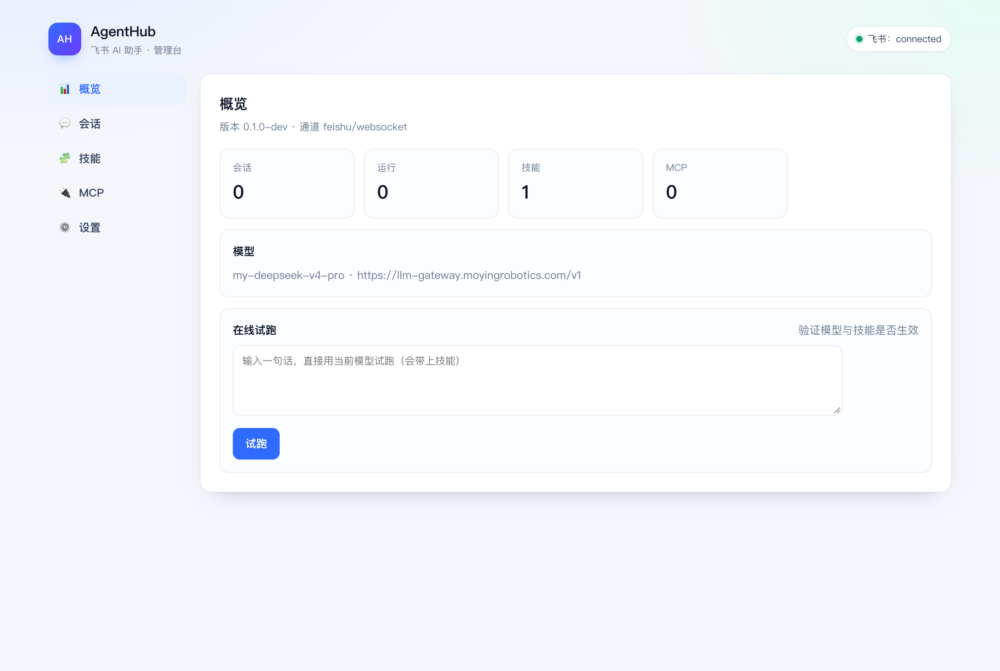

# AgentHub 项目介绍

## 一句话

**AgentHub 是跑在飞书 / 钉钉里的团队 AI 同事：能干活、有过程、可治理，而不是一个网页聊天框。**

## 它解决什么问题

团队用 AI 的常见状态是「演示很惊艳，日常用不起来」：

1. **入口太远** —— 要开网页、复制粘贴，同事不愿意用；
2. **只会说话** —— 不能读文件、跑命令、查日志，最后还是要人来做；
3. **过程黑盒** —— 只有一个转圈，卡住了不知道卡在哪；
4. **无法治理** —— 技能、工具、模型散落在各人电脑和配置文件里，改了没人知道。

AgentHub 把入口放进飞书/钉钉，把执行放进独立工作区，把过程做成事件与卡片，把配置放进管理台，
把状态存进 PostgreSQL。

## 我们的优势

不是「用了 pi」——pi 是开源组件。优势在把它装进日常 IM，并补齐团队需要的治理与运维：

| 优势 | 具体是什么 |
|---|---|
| **双通道** | 飞书 + 钉钉，同一套 Engine、投递、审计；AA 只有钉钉 |
| **pi 级执行** | 每会话代独立工作区与会话文件；能 `bash`、改文件、搜索、压缩上下文、重启恢复 |
| **管理台** | 技能文件树 / ZIP 导入、MCP 热更新、定时任务、审计、队列与优先级、模型热更新 |
| **调度** | 跨会话并发上限、公平队列 + 等待老化、每会话限流 |
| **运维** | 单镜像内置 Node + pi、自动迁移、备份恢复、Prometheus 告警、tag 自动发版 |
| **工程约束** | 批次冻结、单会话单运行、投递幂等、`trace_id`、`-race` 测试 |

一句话：**别人给你一个 agent，我们给你一个能在群里长期运行、可管可查的 agent 服务。**

## 和普通机器人的区别

| 普通机器人 | AgentHub |
|---|---|
| 一问一答，答完即走 | 批次、会话代、pi 会话文件，多轮上下文可恢复 |
| 固定提示词 | 技能即文件（`SKILL.md` + `references/`），按需加载、可编辑、可导入 |
| 只会说话 | 工作区里 `read` / `bash` / `grep` / `find` / 编辑文件，另接 MCP 工具 |
| 出错就沉默 | 进度卡片、阶段事件、`trace_id` 贯通日志、投递重试与重启补偿 |
| 配置在代码里 | 管理台改技能 / MCP / 模型，改动留审计 |
| 单机脚本 | 容器 + PostgreSQL，双架构镜像、备份恢复、Prometheus 告警 |

## 技术底座：pi 运行时

一次运行由 `pi --mode rpc` 子进程执行：

```
消息 → 批次快照 → 会话工作区（.agenthub-agent / AGENTS.md / attachments / outbox）
     → 预写 v3 会话文件 → pi prompt → 事件流（文本增量、工具调用、settled）
     → 收敛结果 → 飞书卡片 / 钉钉文本
```

- 会话代与工作区一一对应，`/reset` 换新代并清理上一代；
- 技能由 pi 从 `data/pi/agent/skills` 发现，模型按需 `read`；
- MCP 配置从管理台生成 `mcp.json`，保存即同步到已有工作区。

**取舍（如实说）**：镜像 14MB → 388MB；每个并发运行约 100MB 内存；每次运行多一次 Node 启动；
pi 固定 1.4.0、会话文件 v3，升级要回归；`bash` 的安全边界由容器限额承担。

## 适合谁

- 有内部运维/交付流程，希望「问一句就能按手册办事」的团队；
- 想把知识沉淀成技能（Markdown），而不是每次重新提示词的团队；
- 需要审计、可回放、可备份，而非个人玩具的场景。

## 能力一览

- 飞书长连接、钉钉 Stream（均无需公网入口），私聊/群聊、白名单；
- 文本、富文本、图片、文件与引用上下文；
- 进度卡片、结果卡片、长文分块、`/status` `/model` `/stop` `/clear` `/reset` `/help`；
- 技能自带（Markdown 包），文件树编辑、ZIP 导入；
- MCP 工具、定时任务（cron + 时区）、公平调度与限流；
- 管理台：概览、在线/历史会话、Skill、MCP、定时任务、审计；
- 运维：健康检查、指标与告警、备份恢复、镜像发布。

## 部署形态

```
飞书 / 钉钉 ──长连接──> AgentHub（Node 22 + pi 1.4.0 + Go 单镜像）──> PostgreSQL
                              │
                              ├── 模型网关（OpenAI 兼容）
                              ├── MCP 工具
                              └── /data/pi/{agent,sessions,workspaces}
```

- 镜像：`donglog/agenthub`（amd64/arm64），约 388MB；
- 部署：`docker compose up -d`，含 PostgreSQL 与应用；
- 端口：健康/指标 8787，管理台 8788（默认只发布回环）；
- 备份：`scripts/backup.sh` / `scripts/restore.sh`。

## 当前状态

- 版本 `v0.2.2`，镜像已发布；
- 11 个包测试全绿，`go test -race ./...` 通过；
- pi 运行时已在本机与容器内验证（容器 `/test` 正常返回）；
- 真实飞书群的 pi 链路需要部署方用实际应用凭据验证。

## 界面



## 进一步阅读

- [README](../README.md)
- [部署指南](deploy.md)
- [架构](architecture.md)
- [运维手册](runbook.md)
