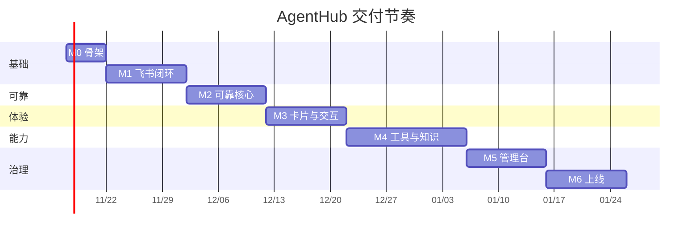

# 路线图

> 估算按 2 人并行（1 后端主力 + 1 全栈/测试），单人开发约 1.8 倍。

## 总览

## M0 骨架（1 周）— 已完成

**交付**：Go module、配置加载与校验、结构化日志、Prometheus 指标、`/healthz`、初始迁移、Dockerfile、Makefile、单元测试。

**出口条件**
- `make run` 启动，`/healthz` 返回 ok；
- 配置缺失退出码 2，日志不含密钥；
- `go test ./...` 通过。

## M1 飞书闭环（2 周）— 进行中

**已完成（模拟验证）**：事件解析、去重、白名单、群聊 @ 判定、批次合并、会话串行、停止、
回复原消息投递、fake API 全链路测试、webhook 入口与来源校验。

**已完成（长连接）**：`FEISHU_TRANSPORT=websocket` 为默认；SDK 握手/心跳/自动重连，
服务侧指数退避，`/healthz` 暴露连接状态；已用真实飞书端点验证鉴权与重试路径。

**已完成（模型与工具）**：OpenAI 兼容执行器（已接公司内部网关）、SKILL.md 技能注入、
MCP stdio 客户端与 tool calling 循环（`mcp_<server>_<tool>`）。

**进行中**：附件流式下载、PostgreSQL 持久化。

**任务**
1. 引入 `larksuite/oapi-sdk-go/v3`，长连接接入与重连；
2. `payload` 解析：text / post / image / file / audio / video；
3. 标准消息模型与去重（`tenant + message_id`）；
4. 会话与成员落库；白名单与 @ 判定；
5. 单轮模型调用（流式）+ 文本回复；
6. 3 秒内 ACK 的时序保障；
7. Spike S1～S5（见能力矩阵）。

**出口条件**
- 私聊、群聊（@）可用；
- 重复事件只处理一次；
- 断网 30s 恢复后消息不丢。

## M2 可靠核心（2 周）

**任务**
1. 持久队列（River）与会话串行（行锁/唯一索引）；
2. 批次快照、上限截断、附件预取；
3. Run 状态机与终态；
4. outbox：幂等键、租约、退避重试、`AMBIGUOUS`；
5. 启动恢复：中断标定、队列重排、投影校准。

**出口条件**
- `kill -9` 后重启零丢失、零重复；
- 5 连发只产生 1 次运行；
- 取消与成批竞态用例通过。

## M3 卡片与交互（2 周）

**任务**
1. 进度卡（cardkit 流式）与结果卡；
2. 停止按钮与权限复检；
3. 表情六态投影与降级；
4. 命令：`/help /status /stop /clear /reset`；
5. 回复关联与轮次编号；
6. 卡片不可用时的文本降级。

**出口条件**
- 真机点击停止只停本批；
- 卡片失败仍交付；
- 非会话所有者不能停止。

## M4 工具与知识（3 周）

**任务**
1. 工具注册与 MCP 客户端；
2. 沙箱：容器、只读挂载、egress 白名单、资源限额；
3. 内置工具：文件解析、代码执行、搜索；
4. 多模型路由与成本记录；
5. 知识库：飞书云文档同步 + 混合检索；
6. 记忆：`/remember` `/forget`。

**出口条件**
- 工具调用全量审计；
- 越权用例（跨会话文件、外网、宿主机）全部拒绝；
- 回答附来源。

## M5 治理（2 周）

**任务**
1. 管理台（templ + htmx）：会话回放、运行详情、失败重投；
2. 配额与限流；
3. 审计与配置版本；
4. 成本看板。

**出口条件**
- 管理台可完成一次"发现问题 → 回放 → 重投"闭环；
- 未授权访问被拒绝。

## M6 上线（2 周）

**任务**
1. 通道抽象与第二个通道（钉钉或企微，验证抽象）；
2. 压测：500 会话 / 50 并发；
3. 灰度与回滚演练；
4. 文档与交付验收。

**出口条件**
- 压测达标；
- 非实现者按文档可复现部署；
- 回滚演练通过。

## 风险缓冲

| 风险 | 缓冲 |
|---|---|
| 卡片回调不可用 | M3 预留 3 天做 webhook 备选 |
| 权限审批延迟 | 提前 2 周申请，先按 @ 设计 |
| 沙箱复杂度 | 容器方案兜底，gVisor 作为增强 |
| 模型限流 | 多 provider 与降级模型 |
